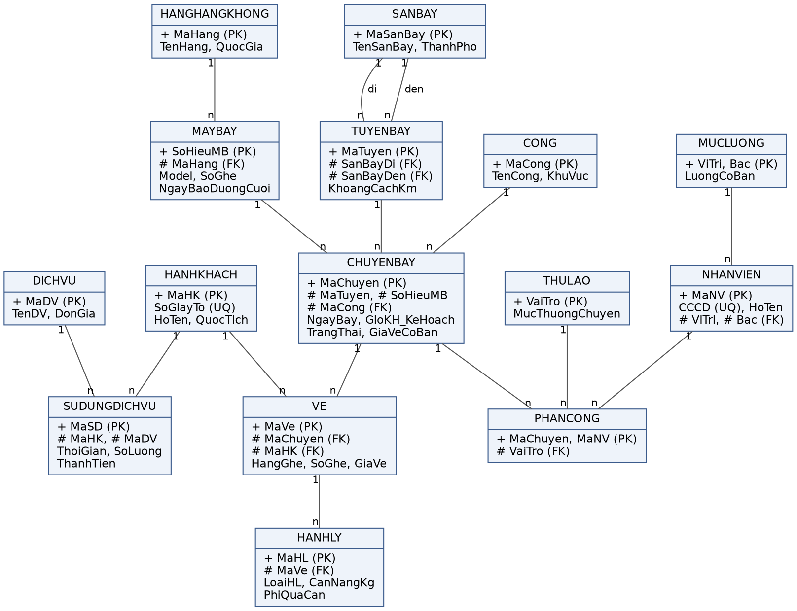

# Quản lý Sân bay — Web demo CSDL

Web minh họa cho bài tập lớn môn **Cơ sở dữ liệu**: *Thiết kế cơ sở dữ liệu hệ thống quản lý sân bay*
(Học viện Công nghệ Bưu chính Viễn thông — Khoa An toàn thông tin).

Toàn bộ thiết kế trong báo cáo được cài đặt và chạy được: 15 bảng, ràng buộc R1–R10, truy vấn Q1–Q5, dữ liệu mẫu theo kế hoạch mục 9.

**Bản chạy trực tuyến:** https://quan-ly-san-bay.onrender.com/

[](https://render.com/deploy?repo=https://github.com/NaraDuyy/quan-ly-san-bay)

## Triển khai công khai (Render, miễn phí)

1. Bấm nút **Deploy to Render** ở trên, đăng nhập Render bằng tài khoản GitHub.
2. Render đọc `render.yaml`, chọn gói **Free**, bấm **Deploy Blueprint**. Sau vài phút sẽ có địa chỉ dạng `https://quan-ly-san-bay-xxxx.onrender.com`.
3. Mỗi lần `git push` lên nhánh `main`, Render tự build và triển khai lại.

Lưu ý gói miễn phí: máy chủ ngủ sau 15 phút không có truy cập (lần mở đầu tiên chờ khoảng 1 phút),
và ổ đĩa không lưu lâu dài — mỗi lần khởi động lại, dữ liệu được nạp lại từ đầu. Mọi người truy cập đều có thể sửa dữ liệu demo.



## Tính năng

| Màn hình | Nội dung |
|---|---|
| **Tổng quan** | Chỉ số khai thác, biểu đồ doanh thu theo tháng, chuyến sắp khởi hành kèm kiểm tra tổ phục vụ (R9), cảnh báo bảo dưỡng, so sánh số bản ghi với kế hoạch. Có nút nạp lại dữ liệu mẫu. |
| **Q1 – Q5** | Năm truy vấn trong báo cáo, có tham số và hiển thị kèm câu lệnh SQL. |
| **Bán vé** | Chọn chuyến, chọn ghế trên sơ đồ, khách cũ hoặc khách mới, thêm hành lý (phí quá cước tính trực tiếp theo G4). Vé, khách và hành lý được ghi trong **một transaction**. |
| **Chi tiết chuyến** | Đổi trạng thái (R9), phân công / gỡ nhân viên (R10), danh sách vé, sơ đồ ghế. |
| **Ràng buộc R1–R10** | Kiểm tra dữ liệu hiện có, nút **Thử vi phạm** cho từng ràng buộc (chạy trong transaction rồi luôn ROLLBACK). |
| **Báo cáo thiết kế** | Giả định G1–G8, thực thể, ERD, lược đồ quan hệ, chuẩn hóa, từ điển dữ liệu. |
| **Quản lý dữ liệu** | Thêm / sửa / xóa / tìm kiếm / sắp xếp cho cả 15 bảng; lỗi ràng buộc được báo bằng thông báo nghiệp vụ. |

## Chạy chương trình

Yêu cầu: **Node.js ≥ 22.13** (dùng module `node:sqlite` có sẵn, không cần cài máy chủ CSDL).

```bash
npm install
```

```bash
npm start
```

Mở http://localhost:3000. Lần chạy đầu sẽ tự tạo `data/sanbay.db` và nạp dữ liệu mẫu.

Các lệnh khác:

| Lệnh | Tác dụng |
|---|---|
| `npm run seed` | Tạo lại dữ liệu mẫu đúng kế hoạch mục 9 (neo theo ngày hiện tại) |
| `npm run seed:lon` | Bộ dữ liệu lớn (150 chuyến, 600 khách, ~9.000 vé) — tỉ lệ lấp đầy thực tế hơn |
| `npm run export:mysql` | Xuất `database/mysql/04_seed.sql` từ cùng bộ sinh dữ liệu |
| `npm test` | Chạy kiểm thử API (dữ liệu mẫu, R1–R10, Q1–Q5, bán vé, CRUD) |
| `npm run dev` | Chạy và tự khởi động lại khi sửa mã |

> Với khối lượng kế hoạch (40 hành khách, mỗi khách tối đa 1 vé/chuyến theo R2), một chuyến có nhiều nhất 40 vé,
> nên tỉ lệ lấp đầy Q1 chỉ vài phần trăm. Muốn thấy chuyến gần đầy, dùng `npm run seed:lon` hoặc chọn “Quy mô lớn” trên trang Tổng quan.

## Cài đặt trên MySQL 8

Thư mục `database/mysql/` là bản cài đặt đúng theo báo cáo (ENUM, DECIMAL, trigger `SIGNAL SQLSTATE '45000'`):

```bash
mysql -u root -p < database/mysql/01_schema.sql
```

```bash
mysql -u root -p < database/mysql/02_triggers.sql
```

```bash
mysql -u root -p < database/mysql/04_seed.sql
```

```bash
mysql -u root -p < database/mysql/03_queries.sql
```

| File | Nội dung |
|---|---|
| `01_schema.sql` | 15 bảng, khóa chính/ngoại, UNIQUE (R2, R3), CHECK (R7…), chỉ mục mục 8.2 |
| `02_triggers.sql` | Trigger R1, R4, R5, R6, R8, R10; thủ tục `sp_doi_trang_thai_chuyen` cho R9 |
| `03_queries.sql` | Q1–Q5 tham số hóa bằng biến `@...` |
| `04_seed.sql` | Dữ liệu mẫu (sinh bởi `npm run export:mysql`) |

## Cấu trúc thư mục

```
├── server/
│   ├── index.js          # Express: API /api + phục vụ giao diện tĩnh
│   ├── db.js             # Kết nối SQLite, transaction, thông báo lỗi nghiệp vụ
│   ├── schema.sql        # Lược đồ + trigger trên SQLite (bản web)
│   ├── seed.js           # Sinh dữ liệu mẫu theo mục 9, xuất script MySQL
│   ├── rules.js          # Giả định G1–G8, phí quá cước, kiểm tra R9, sơ đồ ghế
│   ├── meta.js           # Siêu dữ liệu 15 bảng cho màn hình quản trị
│   ├── queries.js        # Q1–Q5
│   └── routes/           # crud.js, ops.js (nghiệp vụ), constraints.js (R1–R10)
├── public/               # Giao diện (HTML/CSS/JS thuần, không cần build)
├── database/mysql/       # Bản cài đặt MySQL 8
├── test/                 # Kiểm thử bằng node:test
└── docs/erd.png          # Sơ đồ ERD trong báo cáo
```

## Cách cài đặt từng ràng buộc

| Mã | Nội dung | Cơ chế |
|---|---|---|
| R1 | Số vé hiệu lực ≤ số ghế tàu bay | Trigger trên VE (và khi đổi tàu bay của chuyến) |
| R2 | Mỗi khách tối đa 1 vé / chuyến | `UNIQUE (MaChuyen, MaHK)` |
| R3 | Mỗi ghế 1 vé / chuyến | `UNIQUE (MaChuyen, SoGhe)` |
| R4 | Cùng tàu bay cách nhau ≥ 120 phút | Trigger trên CHUYENBAY |
| R5 | Cùng cổng cách nhau ≥ 60 phút | Trigger trên CHUYENBAY |
| R6 | Tàu bay quá 180 ngày không nhận chuyến mới | Trigger trên CHUYENBAY |
| R7 | Mỗi kiện ≤ 32 kg | `CHECK (CanNangKg > 0 AND CanNangKg <= 32)` |
| R8 | ≤ 1 xách tay, ≤ 3 ký gửi mỗi vé | Trigger trên HANHLY |
| R9 | ≥ 1 điều phối + ≥ 2 làm thủ tục trước khởi hành | Tầng ứng dụng khi chuyển sang `LAM_THU_TUC` (MySQL: thủ tục lưu trữ) |
| R10 | Nhân viên không trùng lịch < 120 phút | Trigger trên PHANCONG |

Các quyết định khi cài đặt (bổ sung cho báo cáo):

- Chuyến ở trạng thái `HUY` không chiếm lịch tàu bay, cổng hay nhân viên nên được bỏ qua khi kiểm tra R4, R5, R10.
- G4: phần lẻ của 1 kg vượt định mức được làm tròn lên 1 kg (ví dụ 25,4 kg → vượt 3 kg → 300.000 đ).
- Hủy chuyến sẽ chuyển các vé còn hiệu lực sang `DA_HUY`; doanh thu (G8) và tổng chi tiêu (Q3) không tính vé đã hủy.
- Q2 cho tháng hiện tại chỉ cộng thưởng các chuyến đã khởi hành tính đến thời điểm xem.
- Mục 5.4 (giá lịch sử): trong dữ liệu mẫu, suất ăn nhà ga tăng giá từ 120.000 đ lên 150.000 đ đầu tháng này; các lượt dùng cũ vẫn giữ thành tiền theo giá cũ.
