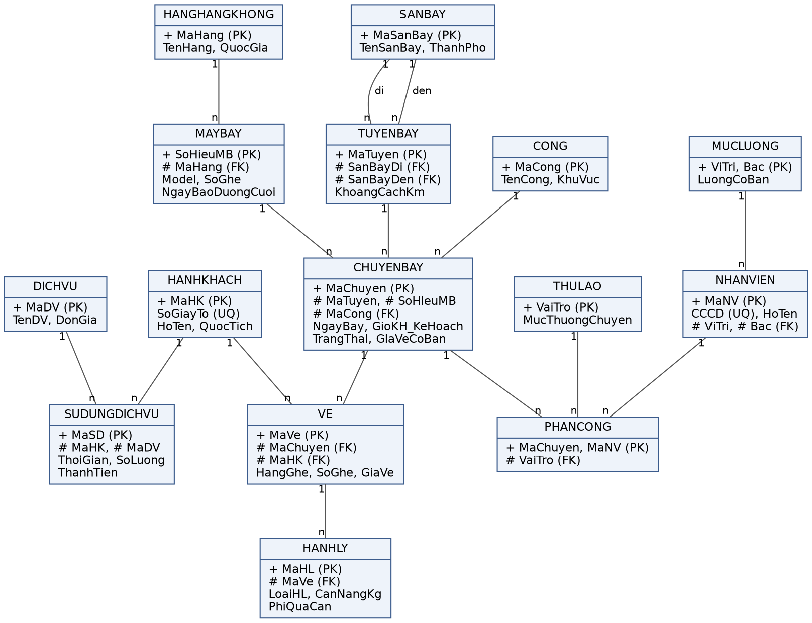
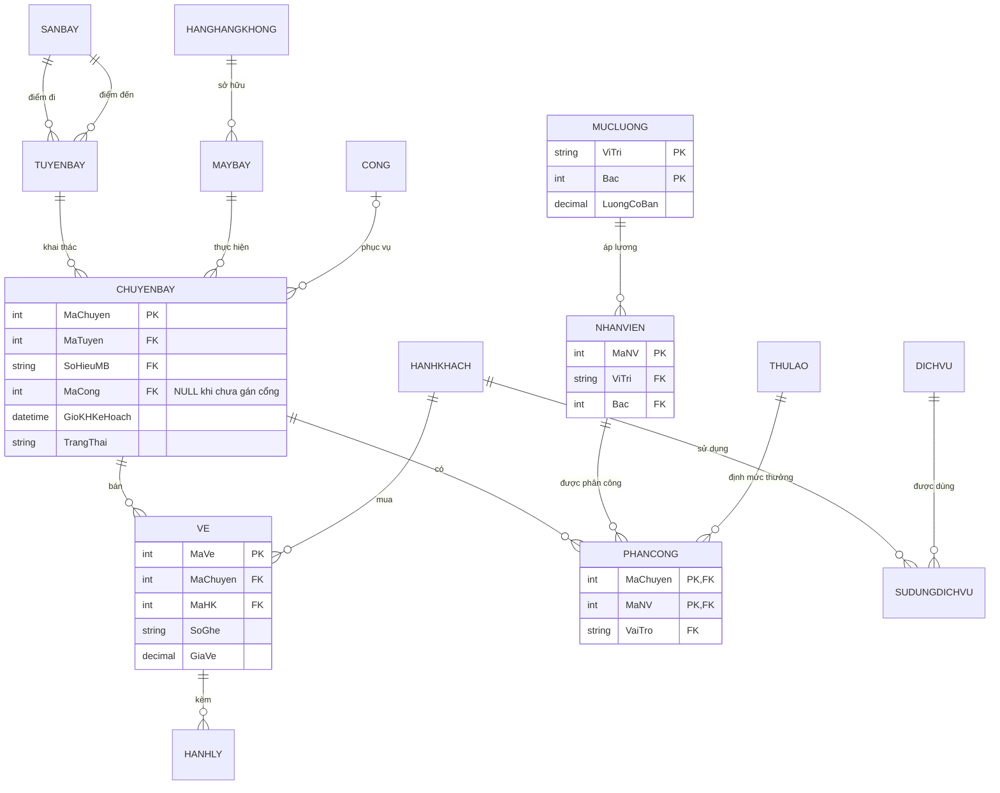

# Hướng dẫn đọc lược đồ ER, lược đồ quan hệ và các giả định thêm / bớt

Tài liệu này giúp đọc hiểu hai sơ đồ trong báo cáo (mục 3 và mục 4) và liệt kê những giả định mà bản cài đặt
đã **thêm, làm rõ hoặc thay đổi** so với báo cáo — để trả lời khi được hỏi "sao web lại làm như vậy?".

- Ảnh ERD gốc trong báo cáo: [`docs/erd.png`](erd.png)
- Lược đồ cài đặt: [`server/schema.sql`](../server/schema.sql) (SQLite, bản web) và [`database/mysql/01_schema.sql`](../database/mysql/01_schema.sql) (MySQL 8)

---

## 1. Đọc lược đồ thực thể – liên kết (ERD)



### 1.1. Ký hiệu trong hình

| Ký hiệu | Ý nghĩa | Ví dụ |
|---|---|---|
| Hộp chữ nhật | Một **thực thể** (sau này thành một bảng) | `CHUYENBAY` |
| `+` đứng trước thuộc tính | **Khóa chính (PK)** — xác định duy nhất một bản ghi | `+ MaChuyen (PK)` |
| `#` đứng trước thuộc tính | **Khóa ngoại (FK)** — trỏ sang khóa chính của thực thể khác | `# SoHieuMB (FK)` trỏ sang `MAYBAY` |
| `(UQ)` | **Duy nhất** nhưng không phải khóa chính | `SoGiayTo (UQ)` của hành khách |
| Đường nối có `1` và `n` ở hai đầu | **Mối liên kết 1 – n**: đầu `1` là bên "một", đầu `n` là bên "nhiều" | `HANGHANGKHONG 1 — n MAYBAY` |
| Chữ trên đường nối (`di`, `den`) | **Vai trò** khi hai thực thể nối với nhau nhiều lần | `SANBAY` nối 2 lần với `TUYENBAY` |

Hình chỉ ghi những thuộc tính tiêu biểu; danh sách đầy đủ ở lược đồ quan hệ (phần 2) và từ điển dữ liệu (mục 6 báo cáo).

### 1.2. Cách đọc một mối liên kết

Luôn đọc **theo cả hai chiều**, mỗi chiều một câu:

> `HANGHANGKHONG 1 — n MAYBAY`
> - Một hãng hàng không **có nhiều** tàu bay.
> - Một tàu bay **thuộc đúng một** hãng.

Quy tắc ghi nhớ: **khóa ngoại luôn nằm ở đầu `n`**. Tàu bay ở đầu `n` nên `MAYBAY` giữ `# MaHang`.

### 1.3. Đọc toàn bộ sơ đồ theo cụm

Sơ đồ xoay quanh **`CHUYENBAY`** (thực thể trung tâm). Có thể đọc thành 4 cụm:

**Cụm khai thác — "chuyến bay bay trên đường nào, bằng tàu nào, ra cổng nào"**

| Liên kết | Đọc là |
|---|---|
| `SANBAY 1 — n TUYENBAY` (vai trò `di`) | Một sân bay là điểm đi của nhiều đường bay |
| `SANBAY 1 — n TUYENBAY` (vai trò `den`) | Một sân bay là điểm đến của nhiều đường bay → `TUYENBAY` có **hai** khóa ngoại cùng trỏ về `SANBAY`: `SanBayDi`, `SanBayDen` |
| `TUYENBAY 1 — n CHUYENBAY` | Một đường bay có nhiều chuyến; mỗi chuyến bay trên một đường |
| `HANGHANGKHONG 1 — n MAYBAY` | Một hãng có nhiều tàu bay |
| `MAYBAY 1 — n CHUYENBAY` | Một tàu bay thực hiện nhiều chuyến (ở các giờ khác nhau, R4) |
| `CONG 1 — n CHUYENBAY` | Một cổng phục vụ nhiều chuyến (ở các giờ khác nhau, R5) |

**Cụm hành khách — "ai mua vé, mang gì, dùng dịch vụ gì"**

| Liên kết | Đọc là |
|---|---|
| `CHUYENBAY 1 — n VE` | Một chuyến bán nhiều vé |
| `HANHKHACH 1 — n VE` | Một khách có nhiều vé (trên nhiều chuyến khác nhau, R2) |
| `VE 1 — n HANHLY` | Một vé kèm nhiều kiện hành lý (tối đa 1 xách tay + 3 ký gửi, R8) |
| `HANHKHACH 1 — n SUDUNGDICHVU n — 1 DICHVU` | Khách và dịch vụ là **n – n**, được tách qua bảng trung gian `SUDUNGDICHVU` |

**Cụm nhân sự — "ai phục vụ chuyến nào, lương bao nhiêu"**

| Liên kết | Đọc là |
|---|---|
| `CHUYENBAY 1 — n PHANCONG n — 1 NHANVIEN` | Chuyến bay và nhân viên là **n – n**, tách qua bảng trung gian `PHANCONG` (kèm `VaiTro`) |
| `THULAO 1 — n PHANCONG` | Mỗi vai trò có một mức thưởng, áp cho nhiều lượt phân công |
| `MUCLUONG 1 — n NHANVIEN` | Mỗi khung (vị trí, bậc) áp cho nhiều nhân viên |

### 1.4. Mối liên kết n – n được "phân rã" thế nào

Mô hình quan hệ không lưu trực tiếp được n – n, nên mỗi mối n – n được thay bằng **một thực thể kết hợp** và **hai mối 1 – n**:

```
CHUYENBAY  n ─── n  NHANVIEN          (một chuyến nhiều nhân viên, một nhân viên nhiều chuyến)
        ⇩ phân rã
CHUYENBAY 1 ─── n PHANCONG n ─── 1 NHANVIEN
                   + (MaChuyen, MaNV)   ← khóa chính ghép từ hai khóa ngoại
                   # VaiTro            ← thuộc tính của chính mối liên kết
```

`SUDUNGDICHVU` cũng vậy, nhưng dùng khóa thay thế `MaSD` vì một khách có thể dùng **cùng một dịch vụ nhiều lần**
(cặp `MaHK, MaDV` không duy nhất).

### 1.5. ERD vẽ lại có bản số tối thiểu (0 hay 1)

Hình trong báo cáo chỉ ghi bản số tối đa (`1`, `n`). Bản dưới đây (GitHub tự vẽ từ mã Mermaid) thêm bản số **tối thiểu**,
suy ra từ `NULL` / `NOT NULL` của khóa ngoại. Ký hiệu chân chim: `||` = đúng một, `|o` = không hoặc một, `o{` = không hoặc nhiều.



Đọc ví dụ: `CONG |o--o{ CHUYENBAY` — một chuyến có **không hoặc một** cổng (`MaCong` cho phép NULL khi chưa gán cổng),
một cổng phục vụ **không hoặc nhiều** chuyến.

---

## 2. Đọc lược đồ quan hệ

### 2.1. Quy ước

Trong báo cáo (mục 4): **gạch chân, in đậm = khóa chính**, *in nghiêng = khóa ngoại*. Trong tài liệu này viết là
**<ins>khóa chính</ins>** và *khóa ngoại*.

| Quan hệ | Thuộc tính |
|---|---|
| SANBAY | (**<ins>MaSanBay</ins>**, TenSanBay, ThanhPho, QuocGia) |
| HANGHANGKHONG | (**<ins>MaHang</ins>**, TenHang, QuocGia, SdtLienHe) |
| MAYBAY | (**<ins>SoHieuMB</ins>**, *MaHang*, HangSanXuat, Model, SoGhe, NamSanXuat, NgayBaoDuongCuoi) |
| TUYENBAY | (**<ins>MaTuyen</ins>**, *SanBayDi*, *SanBayDen*, KhoangCachKm, ThoiGianBayPhut) |
| CONG | (**<ins>MaCong</ins>**, TenCong, KhuVuc, LoaiCong) |
| CHUYENBAY | (**<ins>MaChuyen</ins>**, SoHieuChuyen, *MaTuyen*, *SoHieuMB*, *MaCong*, NgayBay, GioKHKeHoach, GioKHThucTe, GioDenKeHoach, TrangThai, GiaVeCoBan) |
| HANHKHACH | (**<ins>MaHK</ins>**, SoGiayTo, HoTen, NgaySinh, QuocTich, Sdt, Email) |
| VE | (**<ins>MaVe</ins>**, *MaChuyen*, *MaHK*, HangGhe, SoGhe, GiaVe, NgayDat, TrangThai) |
| HANHLY | (**<ins>MaHL</ins>**, *MaVe*, LoaiHL, CanNangKg, PhiQuaCan) |
| MUCLUONG | (**<ins>ViTri, Bac</ins>**, LuongCoBan) |
| NHANVIEN | (**<ins>MaNV</ins>**, CCCD, HoTen, NgaySinh, DiaChi, Sdt, *ViTri*, *Bac*, ThamNienNam) |
| THULAO | (**<ins>VaiTro</ins>**, MucThuongChuyen) |
| PHANCONG | (**<ins>*MaChuyen*, *MaNV*</ins>**, *VaiTro*) |
| DICHVU | (**<ins>MaDV</ins>**, TenDV, DonGia, MoTa) |
| SUDUNGDICHVU | (**<ins>MaSD</ins>**, *MaHK*, *MaDV*, ThoiGian, SoLuong, ThanhTien) |

### 2.2. Đọc từng dòng

Lấy `VE (MaVe, MaChuyen, MaHK, HangGhe, SoGhe, GiaVe, NgayDat, TrangThai)`:

1. **Tên quan hệ** = tên bảng: `VE`.
2. **Khóa chính** `MaVe`: mỗi vé có một mã riêng, không trùng.
3. **Khóa ngoại** `MaChuyen` → `CHUYENBAY.MaChuyen`, `MaHK` → `HANHKHACH.MaHK`: vé thuộc một chuyến và một khách.
   Khóa ngoại phải trỏ tới bản ghi **có thật** (toàn vẹn tham chiếu) — không thể bán vé cho chuyến không tồn tại.
4. **Thuộc tính còn lại** mô tả chính vé đó.
5. Ràng buộc đi kèm (mục 6, 7): `UNIQUE (MaChuyen, MaHK)` là R2, `UNIQUE (MaChuyen, SoGhe)` là R3.

### 2.3. Các trường hợp đặc biệt cần nắm

| Trường hợp | Ở đâu | Giải thích |
|---|---|---|
| **Khóa chính ghép** | `MUCLUONG (ViTri, Bac)` | Phải biết cả vị trí **và** bậc mới ra một mức lương. |
| **Khóa chính ghép từ 2 khóa ngoại** | `PHANCONG (MaChuyen, MaNV)` | Mỗi cặp (chuyến, nhân viên) chỉ có một dòng → một người không được phân công 2 lần vào cùng chuyến. |
| **Khóa ngoại ghép** | `NHANVIEN (ViTri, Bac)` → `MUCLUONG (ViTri, Bac)` | Hai cột cùng nhau mới trỏ được sang một dòng của `MUCLUONG`. |
| **Hai khóa ngoại cùng trỏ một bảng** | `TUYENBAY (SanBayDi, SanBayDen)` → `SANBAY` | Tương ứng hai vai trò `di`, `den` trong ERD; thêm `CHECK (SanBayDi <> SanBayDen)`. |
| **Khóa ngoại được phép NULL** | `CHUYENBAY.MaCong` | Chuyến mới lên lịch có thể chưa được gán cổng. |
| **Khóa tự nhiên vs khóa thay thế** | `SANBAY.MaSanBay` (mã IATA), `MAYBAY.SoHieuMB` (số đăng bạ) là khóa tự nhiên; các bảng còn lại dùng mã tự tăng | Khóa tự nhiên có sẵn ý nghĩa và ổn định; khóa thay thế dùng khi không có mã tự nhiên ngắn gọn. |
| **Thuộc tính dẫn xuất lưu có chủ đích** | `VE.GiaVe`, `HANHLY.PhiQuaCan`, `SUDUNGDICHVU.ThanhTien` | Giá tại thời điểm giao dịch, không đổi khi bảng giá đổi (mục 5.4). |

### 2.4. Từ ERD sang lược đồ quan hệ — 3 quy tắc

1. **Mỗi thực thể → một quan hệ**, khóa chính giữ nguyên.
2. **Mỗi mối 1 – n → thêm khóa ngoại vào quan hệ ở đầu `n`** (trỏ về khóa chính bên `1`).
3. **Mỗi mối n – n → một quan hệ mới** có khóa chính ghép từ hai khóa ngoại, kèm thuộc tính của mối liên kết
   (`PHANCONG.VaiTro`); hoặc dùng khóa thay thế nếu cặp khóa có thể lặp (`SUDUNGDICHVU`).

### 2.5. Lần theo khóa ngoại để trả lời câu hỏi

| Câu hỏi | Đường đi qua các bảng |
|---|---|
| Vé #12 bay từ đâu đến đâu, hãng nào? | `VE` → `CHUYENBAY` → `TUYENBAY` → `SANBAY` (×2); `CHUYENBAY` → `MAYBAY` → `HANGHANGKHONG` |
| Lương tháng của nhân viên #5? (Q2) | `NHANVIEN` → `MUCLUONG` (lương cơ bản); `NHANVIEN` ← `PHANCONG` → `THULAO` (thưởng) và `PHANCONG` → `CHUYENBAY` (lọc tháng, bỏ chuyến hủy) |
| Chuyến còn bao nhiêu ghế? (R1, Q1) | `CHUYENBAY` → `MAYBAY.SoGhe` so với số dòng `VE` không hủy |
| Tổng chi tiêu của khách? (Q3) | `HANHKHACH` ← `VE` (giá vé) ← `HANHLY` (phí quá cước); `HANHKHACH` ← `SUDUNGDICHVU` (dịch vụ) |

---

## 3. Giả định: giữ nguyên, thêm, làm rõ, thay đổi

### 3.1. Giả định trong báo cáo (giữ nguyên)

| Mã | Nội dung | Cài ở đâu |
|---|---|---|
| G1 | Tàu bay quay đầu tối thiểu 120 phút | Trigger R4 |
| G2 | Chu kỳ bảo dưỡng 180 ngày; quá hạn không nhận chuyến mới | Trigger R6, Q5 |
| G3 | Miễn cước 7 kg xách tay, 23 kg/kiện ký gửi; trần 32 kg/kiện | `CHECK` R7, hàm `phiQuaCan` |
| G4 | Phí quá cước 100.000 đ/kg vượt định mức kiện ký gửi | Hàm `phiQuaCan`, tự tính khi lưu hành lý |
| G5 | Tối đa 1 kiện xách tay, 3 kiện ký gửi mỗi vé | Trigger R8 |
| G6 | Thưởng chuyến theo vai trò; lương = cơ bản + thưởng | Bảng `THULAO`, Q2 |
| G7 | Hai chuyến cùng cổng cách nhau ≥ 60 phút | Trigger R5 |
| G8 | Doanh thu = vé chuyến không hủy + phí quá cước + dịch vụ | Q4, Tổng quan |

### 3.2. Giả định **thêm mới** (báo cáo chưa nói tới)

| # | Giả định thêm | Lý do |
|---|---|---|
| T1 | **Chuyến bị hủy không chiếm lịch**: bỏ qua khi kiểm tra R4 (tàu bay), R5 (cổng), R10 (nhân viên) | Hủy chuyến thì tàu, cổng, người phải được dùng cho chuyến khác |
| T2 | **Hủy chuyến → mọi vé còn hiệu lực chuyển sang `DA_HUY`** | Khớp với R1 (đếm vé không hủy) và G8 (không tính doanh thu chuyến hủy) |
| T3 | **Sơ đồ ghế**: các hàng đầu là thương gia (3 hàng, hoặc 6 hàng nếu tàu ≥ 250 ghế), 4 ghế/hàng `A C D F`; còn lại phổ thông 6 ghế/hàng `A–F` | Báo cáo chỉ có `SoGhe VARCHAR(4)`; cần quy ước để vẽ sơ đồ và kiểm tra ghế thuộc đúng hạng khi bán vé |
| T4 | **Giá vé gợi ý**: phổ thông = giá cơ bản, thương gia = 2,5 × giá cơ bản (sửa được khi bán) | Báo cáo chỉ nói `GiaVe` có thể khác `GiaVeCoBan` |
| T5 | **Chuyến mới không được tạo thẳng ở *Làm thủ tục*, *Đã cất cánh*, *Đã hạ cánh* hay *Trễ*** (thường tạo ở *Lên lịch*) | Để R9 có ý nghĩa: phân công tổ phục vụ trước rồi mới chuyển trạng thái |
| T6 | **Q5 thêm mức "sắp tới hạn"** (trong 30 ngày) và số chuyến sắp tới của từng tàu | Cảnh báo sớm, ngoài danh sách quá hạn mà báo cáo yêu cầu |
| T7 | Thêm vài `CHECK` không âm / lớn hơn 0 (khoảng cách, thời gian bay, số lượng, thành tiền, phí…) và `GioDenKeHoach > GioKHKeHoach` | Chặn dữ liệu vô lý mà báo cáo chưa liệt kê |
| T8 | Mọi mốc thời gian tính theo **giờ Việt Nam** | Sân bay ở Hà Nội; máy chủ Render chạy giờ UTC |
| T9 | Bảng **`TAIKHOAN`** và 4 vai trò (Quản trị, Bán vé, Điều phối, Kế toán) | Phục vụ đăng nhập trên web; **không** thuộc 15 bảng của thiết kế CSDL |

### 3.3. Giả định **làm rõ** (báo cáo có nói nhưng chưa cụ thể)

| # | Chỗ chưa rõ trong báo cáo | Bản cài đặt hiểu là |
|---|---|---|
| L1 | G4: vượt lẻ (ví dụ 25,4 kg) tính thế nào? | **Làm tròn lên** từng kg: 25,4 kg → vượt 3 kg → 300.000 đ |
| L2 | G3 có 7 kg xách tay, nhưng G4 chỉ thu phí kiện **ký gửi** | Xách tay quá 7 kg **không thu phí**, chỉ bị chặn nếu quá 32 kg (R7) |
| L3 | Q2 "tính đến thời điểm hiện tại" | Tháng hiện tại chỉ cộng thưởng các chuyến **đã khởi hành**; luôn bỏ chuyến hủy |
| L4 | Q3 "tổng chi tiêu" | Không tính vé đã hủy và vé thuộc chuyến bị hủy (cùng cách hiểu với G8) |
| L5 | Q4: doanh thu thuộc tháng nào? | Tiền vé và phí hành lý theo **tháng bay** (`NgayBay`); dịch vụ theo **tháng sử dụng** (`ThoiGian`); bỏ cả vé đã hủy |
| L6 | R1 chỉ nói khi bán vé | Kiểm tra cả khi **khôi phục vé đã hủy**, chuyển vé sang chuyến khác và khi **đổi tàu bay** nhỏ hơn số vé đã bán |
| L7 | Trigger chỉ nói `BEFORE INSERT` cho R6, R8, R10 | Cài cả `BEFORE UPDATE`, để sửa dữ liệu cũng không lách được ràng buộc |
| L8 | `NgayBay` và `GioDenKeHoach` | Bỏ trống thì tự suy ra: `NgayBay` = ngày của giờ khởi hành, `GioDenKeHoach` = giờ khởi hành + thời gian bay của tuyến |
| L9 | `ThanhTien` = số lượng × đơn giá "tại thời điểm dùng" | Sửa số lượng thì giữ đơn giá cũ; đổi sang dịch vụ khác thì lấy đơn giá hiện hành |

### 3.4. Thay đổi / bớt so với báo cáo

| # | Báo cáo | Bản cài đặt | Lý do |
|---|---|---|---|
| B1 | Kiểu MySQL 8 (`ENUM`, `SIGNAL`) | Web chạy **SQLite**: `ENUM` → `CHECK (… IN (…))`, `SIGNAL` → `RAISE(ABORT, …)`. Bản MySQL đầy đủ vẫn có trong `database/mysql/` | Chạy miễn phí, không cần máy chủ CSDL |
| B2 | Khóa ngoại `ON UPDATE CASCADE` | Bản MySQL: hai khóa ngoại của `TUYENBAY` dùng `ON UPDATE RESTRICT` | MySQL không cho cột vừa có `CHECK` vừa có hành động tham chiếu (lỗi 3823) |
| B3 | Phạm vi: không quản lý phi hành đoàn, kiểm soát không lưu, bán lẻ | **Giữ nguyên**, không thêm tài khoản phi công / tiếp viên | Đúng mục 1.2 |
| B4 | Phụ lục A.3 (Redis cache) | **Chưa cài** | Phần nâng cao, không cần cho khối lượng dữ liệu mẫu |

### 3.5. Giả định riêng của dữ liệu mẫu (không phải ràng buộc CSDL)

- Dữ liệu **neo theo ngày tạo**: 3 tháng gần nhất (2 tháng trước + tháng hiện tại), nên luôn có chuyến đã bay và chuyến sắp bay.
- 5 sân bay đối tác gồm 4 sân bay trong nước và **Incheon (ICN)**; chuyến quốc tế xếp vào cổng `QUOC_TE` (nhà ga T2).
  Đây là quy ước khi sinh dữ liệu, **CSDL không ép** loại cổng phải khớp loại chuyến.
- Hai tàu bay quá hạn bảo dưỡng (VN-A632, VN-A699) và một tàu sắp tới hạn (VN-A588) để Q5 có dữ liệu.
- Suất ăn nhà ga tăng giá từ 120.000 đ lên 150.000 đ đầu tháng hiện tại, minh họa giá lịch sử (mục 5.4).
- Với 40 hành khách và R2, mỗi chuyến tối đa 40 vé → tỉ lệ lấp đầy Q1 thấp; chọn "quy mô lớn" để có chuyến gần đầy.

---

## 4. Muốn thêm / bớt / đổi một giả định thì sửa ở đâu

Ví dụ câu hỏi hay gặp: *"Nếu đổi thời gian quay đầu (G1) thành 90 phút thì phải sửa những gì?"*

| Giả định | Sửa ở |
|---|---|
| G1 (120 phút), G7 (60 phút), G2 (180 ngày) | Hằng số `G` trong `server/rules.js` (dùng cho Q5, dữ liệu mẫu) **và** con số trong các trigger R4, R5, R6, R10 của `server/schema.sql`; bản MySQL: `database/mysql/02_triggers.sql` |
| G3, G4 (23 kg, 32 kg, 100.000 đ) | `G` trong `server/rules.js`; `CHECK ck_hl_r7` trong `schema.sql` (trần 32 kg); hàm `phi` ở `public/js/pages/sell.js` (hiển thị phí trước khi lưu) |
| G5 (1 xách tay, 3 ký gửi) | Trigger R8 trong `schema.sql` |
| G6 (mức thưởng) | **Không cần sửa mã** — sửa dữ liệu bảng `THULAO` trên web (đăng nhập Quản trị hoặc Kế toán) |
| Lương cơ bản, đơn giá dịch vụ | Sửa dữ liệu bảng `MUCLUONG`, `DICHVU` trên web |
| R9 (số người tối thiểu) | Hàm `kiemTraR9` trong `server/rules.js`; bản MySQL: thủ tục `sp_doi_trang_thai_chuyen` |

Sau khi sửa lược đồ (`schema.sql`) cần tạo lại CSDL: đăng nhập Quản trị → Tổng quan → **Nạp lại dữ liệu mẫu**
(hoặc `npm run seed`), rồi chạy `npm test` để chắc các ràng buộc vẫn đúng.

Điểm đáng nêu khi trả lời: **G6, lương và giá dịch vụ được thiết kế thành dữ liệu** (bảng `THULAO`, `MUCLUONG`, `DICHVU`)
nên đổi được mà không sửa lược đồ — đây chính là lợi ích của việc tách bảng ở bước chuẩn hóa 3NF (mục 5.3).
Còn G1, G2, G5, G7 đang là hằng số trong trigger; nếu muốn đổi linh hoạt có thể tách thành một bảng tham số cấu hình.
